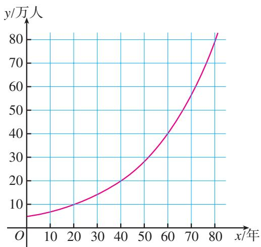

# 例 4 利用指数函数图象估计城市人口倍增期

例 4 如图 4.2-7，某城市人口呈指数增长.

由例 3 可以看到，利用指数函数的单调性，通过自变量的大小关系可以判断相应函数值的大小关系.

（1）根据图象，估计该城市人口每翻一番所需的时间（倍增期）；

（2）该城市人口从80万人开始，经过20年会增长到多少万人？

## 题目补充材料（来源原文）

## 本节相关知识（范围关联）

- [指数函数的图象和性质](../%E7%9F%A5%E8%AF%86%E7%82%B9/%E6%8C%87%E6%95%B0%E5%87%BD%E6%95%B0%E7%9A%84%E5%9B%BE%E8%B1%A1%E5%92%8C%E6%80%A7%E8%B4%A8--000137.md)

## 解析

- [例 4 利用指数函数图象估计城市人口倍增期·解析](%E8%A7%A3%E6%9E%90/Q4266535523382440260A8783724a63.md)

## 所属组织

- [4.2.2 指数函数的图象和性质](../%E9%A2%98%E5%9E%8B/%E4%BA%BA%E6%95%99A-%E5%BF%85%E4%BF%AE%E7%AC%AC%E4%B8%80%E5%86%8C/%E7%AC%AC%E5%9B%9B%E7%AB%A0%20%E6%8C%87%E6%95%B0%E5%87%BD%E6%95%B0%E4%B8%8E%E5%AF%B9%E6%95%B0%E5%87%BD%E6%95%B0/4.2%20%E6%8C%87%E6%95%B0%E5%87%BD%E6%95%B0/4.2.2%20%E6%8C%87%E6%95%B0%E5%87%BD%E6%95%B0%E7%9A%84%E5%9B%BE%E8%B1%A1%E5%92%8C%E6%80%A7%E8%B4%A8.md)
