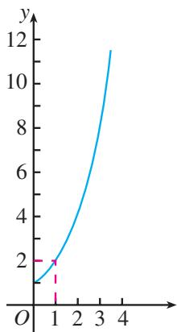

# 习题4.5 综合运用 第9题

9. 如图，某池塘里浮萍的面积 $y$ （单位： $\mathrm{m}^2$ ）与时间 $t$ （单位：月）的关系为 $y = a^t$ . 关于下列说法：

① 浮萍每月的增长率为 1;

② 第 5 个月时，浮萍面积就会超过 $30 \, m^{2}$ ;

③ 浮萍每月增加的面积都相等；

(第9题)

④ 若浮萍蔓延到 $2\mathrm{m}^2$ ， $3\mathrm{m}^2$ ， $6\mathrm{m}^2$ 所经过的时间分别是 $t_1$ ， $t_2$ ， $t_3$ ，则 $t_1 + t_2 = t_3$

其中正确的说法是（ ）.

(A) ①② (B) ①②③ (C) ①②④ (D) ①②③④

## 解析

本来源未提供本题解析。

## 本节相关知识（范围关联）

- [中外历史上的方程求解](../%E7%9F%A5%E8%AF%86%E7%82%B9/%E4%B8%AD%E5%A4%96%E5%8E%86%E5%8F%B2%E4%B8%8A%E7%9A%84%E6%96%B9%E7%A8%8B%E6%B1%82%E8%A7%A3--000054.md)

## 所属组织

- [习题4.5](../%E9%A2%98%E5%9E%8B/%E4%BA%BA%E6%95%99A-%E5%BF%85%E4%BF%AE%E7%AC%AC%E4%B8%80%E5%86%8C/%E7%AC%AC%E5%9B%9B%E7%AB%A0%20%E6%8C%87%E6%95%B0%E5%87%BD%E6%95%B0%E4%B8%8E%E5%AF%B9%E6%95%B0%E5%87%BD%E6%95%B0/%E9%98%85%E8%AF%BB%E4%B8%8E%E6%80%9D%E8%80%83%20%E4%B8%AD%E5%A4%96%E5%8E%86%E5%8F%B2%E4%B8%8A%E7%9A%84%E6%96%B9%E7%A8%8B%E6%B1%82%E8%A7%A3/%E4%B9%A0%E9%A2%984.5.md)
