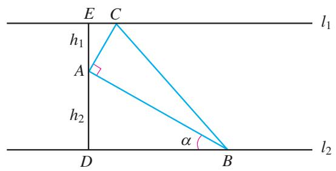

# 第五章 三角函数 复习参考题5 拓广探索 第25题

25. 如图，已知直线 $l_{1} \parallel l_{2}$ ， $A$ 是 $l_{1}, l_{2}$ 之间的一定点，并且点 $A$ 到 $l_{1}, l_{2}$ 的距离分别为 $h_{1}, h_{2}$ . $B$ 是直线 $l_{2}$ 上一动点，作 $AC \perp AB$ ，且使 $AC$ 与直线 $l_{1}$ 交于点 $C$ . 设 $\angle ABD = \alpha$ .

  
(第 25 题)

（1）写出 $\triangle ABC$ 的面积 $S$ 关于角 $\alpha$ 的函数解析式 $S(\alpha)$ ；

(2) 画出上述函数的图象；

(3) 由(2)中的图象求 $S(\alpha)$ 的最小值.

## 解析

本来源未提供本题解析。

## 所属组织

- [第五章 三角函数 复习参考题5](../%E9%A2%98%E5%9E%8B/%E4%BA%BA%E6%95%99A-%E5%BF%85%E4%BF%AE%E7%AC%AC%E4%B8%80%E5%86%8C/%E7%AC%AC%E4%BA%94%E7%AB%A0%20%E4%B8%89%E8%A7%92%E5%87%BD%E6%95%B0/%E7%AC%AC%E4%BA%94%E7%AB%A0%20%E4%B8%89%E8%A7%92%E5%87%BD%E6%95%B0%20%E5%A4%8D%E4%B9%A0%E5%8F%82%E8%80%83%E9%A2%985.md)
