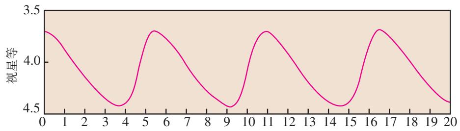

# 习题5.7 综合运用 第1题

1. 天上有些恒星的亮度是会变化的，其中一种称为造父（型）变星，本身体积会膨胀收缩造成亮度周期性的变化。下图是一造父变星的亮度随时间的周期变化图。此变星的亮度变化的周期为多少天？最亮时是几等星？最暗时是几等星？

  
(第1题)

## 解析

本来源未提供本题解析。

## 本节相关知识（范围关联）

- [函数 y=Asin(ωx+φ) 的物理意义与简谐运动模型](../%E7%9F%A5%E8%AF%86%E7%82%B9/%E5%87%BD%E6%95%B0%20y%3DAsin%28%CF%89x%2B%CF%86%29%20%E7%9A%84%E7%89%A9%E7%90%86%E6%84%8F%E4%B9%89%E4%B8%8E%E7%AE%80%E8%B0%90%E8%BF%90%E5%8A%A8%E6%A8%A1%E5%9E%8B--000180.md)

## 所属组织

- [习题5.7](../%E9%A2%98%E5%9E%8B/%E4%BA%BA%E6%95%99A-%E5%BF%85%E4%BF%AE%E7%AC%AC%E4%B8%80%E5%86%8C/%E7%AC%AC%E4%BA%94%E7%AB%A0%20%E4%B8%89%E8%A7%92%E5%87%BD%E6%95%B0/5.7%20%E4%B8%89%E8%A7%92%E5%87%BD%E6%95%B0%E7%9A%84%E5%BA%94%E7%94%A8/%E4%B9%A0%E9%A2%985.7.md)
