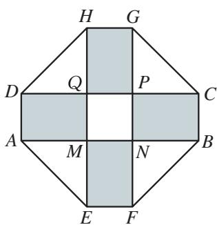

# 第二章 一元二次函数、方程和不等式 复习参考题 2 拓广探索 第9题

9. 如图，居民小区要建一座八边形的休闲场所，它的主体造型平面图是由两个相同的矩形 ABCD 和 EFGH 构成的面积为 $200 \, m^{2}$ 的十字形地域。计划在正方形 MNPQ 上建一座花坛，造价为 $4200 \, 元/m^{2}$ ；在四个相同的矩形（图中阴影部分）上铺花岗岩地坪，造价为 $210 \, 元/m^{2}$ ；再在四个空角（图中四个三角形）上铺草坪，造价为 $80 \, 元/m^{2}$ 。设总造价为 S（单位：元），AD 长为 x（单位：m）。当 x 为何值时，S 最小？并求出这个最小值。

  
(第9题)

## 解析

本来源未提供本题解析。

## 所属组织

- [第二章 一元二次函数、方程和不等式 复习参考题 2](../%E9%A2%98%E5%9E%8B/%E4%BA%BA%E6%95%99A-%E5%BF%85%E4%BF%AE%E7%AC%AC%E4%B8%80%E5%86%8C/%E7%AC%AC%E4%BA%8C%E7%AB%A0%20%E4%B8%80%E5%85%83%E4%BA%8C%E6%AC%A1%E5%87%BD%E6%95%B0%E3%80%81%E6%96%B9%E7%A8%8B%E5%92%8C%E4%B8%8D%E7%AD%89%E5%BC%8F/%E7%AC%AC%E4%BA%8C%E7%AB%A0%20%E4%B8%80%E5%85%83%E4%BA%8C%E6%AC%A1%E5%87%BD%E6%95%B0%E3%80%81%E6%96%B9%E7%A8%8B%E5%92%8C%E4%B8%8D%E7%AD%89%E5%BC%8F%20%E5%A4%8D%E4%B9%A0%E5%8F%82%E8%80%83%E9%A2%98%202.md)
