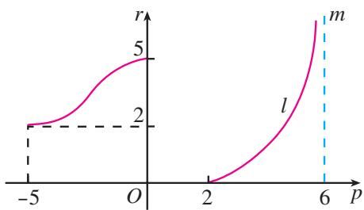

# 习题3.1 综合运用 第11题

11. 函数 $r = f(p)$ 的图象如图所示，（1）函数 $r = f(p)$ 的定义域、值域各是什么？（2） $r$ 取何值时，只有唯一的 $p$ 值与之对应？

  
(第11题)

图中，曲线 $l$ 与直线 $m$ 无限接近，但永不相交.

## 解析

本来源未提供本题解析。

## 所属组织

- [习题3.1](../%E9%A2%98%E5%9E%8B/%E4%BA%BA%E6%95%99A-%E5%BF%85%E4%BF%AE%E7%AC%AC%E4%B8%80%E5%86%8C/%E7%AC%AC%E4%B8%89%E7%AB%A0%20%E5%87%BD%E6%95%B0%E7%9A%84%E6%A6%82%E5%BF%B5%E4%B8%8E%E6%80%A7%E8%B4%A8/3.1%20%E5%87%BD%E6%95%B0%E7%9A%84%E6%A6%82%E5%BF%B5%E5%8F%8A%E5%85%B6%E8%A1%A8%E7%A4%BA/%E4%B9%A0%E9%A2%983.1.md)
