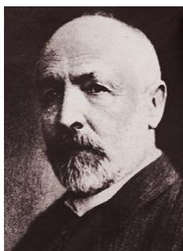

# 习题1.1 拓广探索 第5题

5. 集合论是德国数学家康托尔于 19 世纪末创立的。当时，康托尔在解决涉及无限量研究的数学问题时，越过“数集”限制，提出了一般性的“集合”概念。关于集合论，希尔伯特赞誉其为“数学思想的惊人的产物，在纯粹理性的范畴中人类活动的最美的表现之一”，罗素描述其为“可能是这个时代所能夸耀的最伟大的工作”。请你查阅相关资料，用简短的报告阐述你对这些评价的认识。

  
康托尔（Georg Cantor，1845—1918）

## 解析

本来源未提供本题解析。

## 本节相关知识（范围关联）

- [列举法](../%E7%9F%A5%E8%AF%86%E7%82%B9/%E5%88%97%E4%B8%BE%E6%B3%95--000002.md)
- [描述法](../%E7%9F%A5%E8%AF%86%E7%82%B9/%E6%8F%8F%E8%BF%B0%E6%B3%95--000003.md)
- [集合与元素](../%E7%9F%A5%E8%AF%86%E7%82%B9/%E9%9B%86%E5%90%88%E4%B8%8E%E5%85%83%E7%B4%A0--000001.md)

## 所属组织

- [习题1.1](../%E9%A2%98%E5%9E%8B/%E4%BA%BA%E6%95%99A-%E5%BF%85%E4%BF%AE%E7%AC%AC%E4%B8%80%E5%86%8C/%E7%AC%AC%E4%B8%80%E7%AB%A0%20%E9%9B%86%E5%90%88%E4%B8%8E%E5%B8%B8%E7%94%A8%E9%80%BB%E8%BE%91%E7%94%A8%E8%AF%AD/1.1%20%E9%9B%86%E5%90%88%E7%9A%84%E6%A6%82%E5%BF%B5/%E4%B9%A0%E9%A2%981.1.md)
