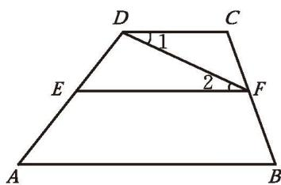

> [!success]- 例题解析
>
> > [!success] **【答案】** 详见解析
>
> > [!note]- **【解析】**
> > 解：因为 $\angle 1 = \angle 2$
> > 根据 “内错角相等，两直线平行”，
> > 所以 $EF \parallel CD$ 。
> > 又因为 $AB \parallel CD$ ,
> >
> > 
> >
> > 根据 “平行于同一条直线的两条直线平行”,
> > 图2-31
> > 所以 $EF \parallel AB$ 。

对应题目：[Q070000000130](../Q070000000130.md)

> 来源：北师大版初中数学·七年级下册
