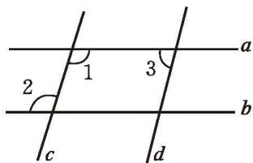

> [!success]- 例题解析
>
> > [!success] **【答案】** 详见解析
>
> > [!note]- **【解析】**
> > 解：因为 $a \parallel b$
> > 根据 “两直线平行，内错角相等”，
> > 所以 $\angle 2 = \angle 1 = 107^{\circ}$ 。
> > 因为 $c \parallel d$ ,
> >
> > 
> >
> > 根据 “两直线平行，同旁内角互补”，
> > 所以 $\angle 1 + \angle 3 = 180^{\circ}$ 。
> > 图2-32
> > 所以 $\angle 3 = 180^{\circ} - \angle 1 = 180^{\circ} - 107^{\circ} = 73^{\circ}$ 。

对应题目：[Q070000000131](../Q070000000131.md)

> 来源：北师大版初中数学·七年级下册
