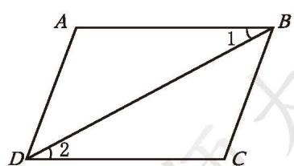

> [!success]- 例题解析
>
> > [!success] **【答案】** 详见解析
>
> > [!note]- **【解析】**
> > 解：因为 $AB \parallel CD$ ，
> > 根据 “两直线平行，内错角相等”，所以 $\angle1=\angle2$ 。
> >
> > 
> > 图4-29
> >
> > 在 $\triangle ABD$ 和 $\triangle CDB$ 中，
> > 因为 $AB = CD, \angle 1 = \angle 2, BD = DB,$
> > 根据三角形全等的判定条件 “SAS”,
> > 所以 $\triangle ABD \cong \triangle CDB$ 。

对应题目：[Q070000000242](../Q070000000242.md)

> 来源：北师大版初中数学·七年级下册
