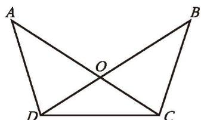

> [!success]- 例题解析
>
> > [!success] **【答案】** 详见解析
>
> > [!note]- **【解析】**
> > 解：(1) 因为 $\angle AOD$ 与 $\angle BOC$ 是对顶角,
> > 根据 “对顶角相等”，
> >
> > 
> >
> > 所以 $\angle AOD=\angle BOC$ 。
> > 在 $\triangle AOD$ 和 $\triangle BOC$ 中，
> > 图4-30
> > 因为 OA = OB， $\angle AOD = \angle BOC$ ，OD = OC，
> > 根据三角形全等的判定条件 “SAS”,
> > 所以 $\triangle AOD \cong \triangle BOC$ 。
> >
> > (2) 由 (1) 可知, $\triangle AOD \cong \triangle BOC$ , 根据 “全等三角形的对应边相等”, 所以 $AD = BC$ 。因为 $OA = OB$ , $OC = OD$ , $AC = OA + OC$ , $BD = OB + OD$ , 所以 $AC = BD$ 。在 $\triangle ACD$ 和 $\triangle BDC$ 中, 因为 $AD = BC$ , $AC = BD$ , $DC = CD$ , 根据三角形全等的判定条件 “SSS”, 所以 $\triangle ACD \cong \triangle BDC$ 。
> > 你还能根据其他的判定条件，判断这两个三角形全等吗？

对应题目：[Q070000000243](../Q070000000243.md)

> 来源：北师大版初中数学·七年级下册
