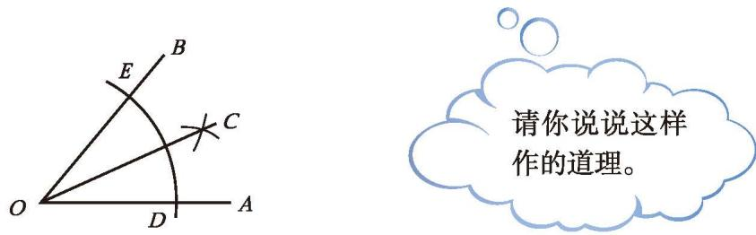

作法：1. 在 $OA$ 和 $OB$ 上分别截取 $OD, OE$ , 使 $OD = OE$ (如图 5-22)。

2. 分别以点 $D$ 和点 $E$ 为圆心, 以大于 $\frac{1}{2} DE$ 的长为半径作弧, 两弧在 $\angle AOB$ 内相交于点 $C$ 。

3. 作射线 OC。

射线 OC 就是 $\angle AOB$ 的平分线。

图5-22

请你说说这样作的道理。

对应题目：[Q070000000304](../Q070000000304.md)

> 来源：北师大版初中数学·七年级下册
