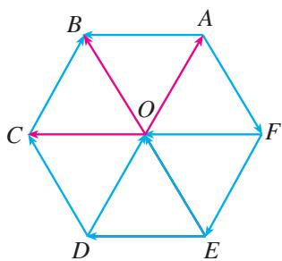

解：（1） $\overrightarrow{OA}$ ， $\overrightarrow{CB}$ ， $\overrightarrow{DO}$ ， $\overrightarrow{FE}$ 是共线向量； $\overrightarrow{OB}$ ， $\overrightarrow{DC}$ ， $\overrightarrow{EO}$ ， $\overrightarrow{AF}$ 是共线向量； $\overrightarrow{OC}$ ， $\overrightarrow{AB}$ ， $\overrightarrow{ED}$ ， $\overrightarrow{FO}$ 是共线向量.

(2) $\overrightarrow{OA} = \overrightarrow{CB} = \overrightarrow{DO};$ $\overrightarrow{OB} = \overrightarrow{DC} = \overrightarrow{EO};$ $\overrightarrow{OC} = \overrightarrow{AB} = \overrightarrow{ED} = \overrightarrow{FO}.$

  
图6.1-8

对应题目：[Q070000000382](../Q070000000382.md)

> 来源：高中必修 第二册·人教A版数学
