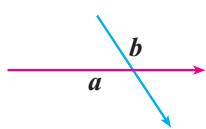
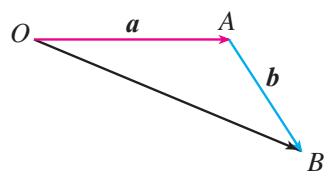
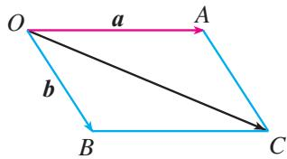

作法1：在平面内任取一点 $O$ （图6.2-6（1）），作 $\overrightarrow{OA} = a$ ， $\overrightarrow{AB} = b$ .则 $\overrightarrow{OB} = a + b$

作法 2：在平面内任取一点 O（图 6.2-6（2）），作 $\overrightarrow{OA}=a,\overrightarrow{OB}=b$ 。以 OA，OB 为邻边作 □OACB，连接 OC，则 $\overrightarrow{OC}=\overrightarrow{OA}+\overrightarrow{OB}=a+b$ 。

  
图6.2-5

  
(1)

  
(2)  
图6.2-6

对应题目：[Q070000000391](../Q070000000391.md)

> 来源：高中必修 第二册·人教A版数学
