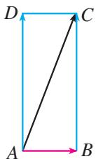

解：（1）如图 6.2-9. $\overrightarrow{AD}$ 表示船速， $\overrightarrow{AB}$ 表示江水速度，以 AD，AB 为邻边作 $\square ABCD$ ，则 $\overrightarrow{AC}$ 表示船实际航行的速度.

(2) 在Rt△ABC中， $|\overrightarrow{AB}|=6,\quad|\overrightarrow{BC}|=15$ ，于是

$$
| \overrightarrow {A C} | = \sqrt {| \overrightarrow {A B} | ^ {2} + | \overrightarrow {B C} | ^ {2}} = \sqrt {6 ^ {2} + 1 5 ^ {2}} = \sqrt {2 6 1} \approx 1 6. 2.
$$

因为 $\tan \angle CAB = \frac{|\overrightarrow{BC}|}{|\overrightarrow{AB}|} = \frac{5}{2}$ ，所以利用计算工具可得 $\angle CAB \approx 68^{\circ}$

图6.2-9

因此，船实际航行速度的大小约为 $16.2 \, km/h$ ，方向与江水速度间的夹角约为 $68^{\circ}$ .

对应题目：[Q070000000392](../Q070000000392.md)

> 来源：高中必修 第二册·人教A版数学
