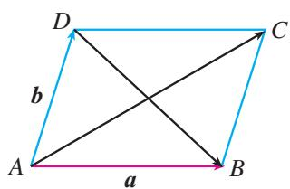

解：由向量加法的平行四边形法则，我们知道

$$
\overrightarrow {A C} = \boldsymbol {a} + \boldsymbol {b}.
$$

同样，由向量的减法，知

$$
\overrightarrow {D B} = \overrightarrow {A B} - \overrightarrow {A D} = a - b.
$$

图6.2-13

对应题目：[Q070000000400](../Q070000000400.md)

> 来源：高中必修 第二册·人教A版数学
