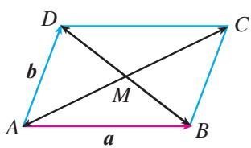

> [!faq]- 高中必修 第二册·人教A版数学
> 解：在□ABCD中，
>
> $$
> \overrightarrow {A C} = \overrightarrow {A B} + \overrightarrow {A D} = \boldsymbol {a} + \boldsymbol {b},
> $$
>
> 
>
> $$
> \overrightarrow {D B} = \overrightarrow {A B} - \overrightarrow {A D} = a - b.
> $$
>
> 图6.2-15
>
> 由平行四边形的两条对角线互相平分，得
>
> $$
> \overrightarrow {M A} = - \frac {1}{2} \overrightarrow {A C} = - \frac {1}{2} (\boldsymbol {a} + \boldsymbol {b}) = - \frac {1}{2} \boldsymbol {a} - \frac {1}{2} \boldsymbol {b},
> $$
>
> $$
> \overrightarrow {M B} = \frac {1}{2} \overrightarrow {D B} = \frac {1}{2} (\boldsymbol {a} - \boldsymbol {b}) = \frac {1}{2} \boldsymbol {a} - \frac {1}{2} \boldsymbol {b},
> $$
>
> $$
> \overrightarrow {M C} = \frac {1}{2} \overrightarrow {A C} = \frac {1}{2} a + \frac {1}{2} b,
> $$
>
> $$
> \overrightarrow {M D} = - \frac {1}{2} \overrightarrow {D B} = - \frac {1}{2} a + \frac {1}{2} b.
> $$
