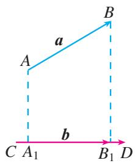
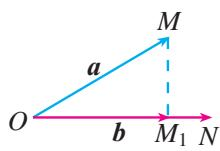

解：由 $a \cdot b = |a||b|\cos \theta$ ，得

$$
\cos \theta = \frac {\boldsymbol {a} \cdot \boldsymbol {b}}{| \boldsymbol {a} | | \boldsymbol {b} |} = \frac {- 5 4 \sqrt {2}}{1 2 \times 9} = - \frac {\sqrt {2}}{2}.
$$

因为 $\theta \in [0, \pi]$ ，所以 $\theta = \frac{3\pi}{4}$ .

如图6.2-20（1），设 $a$ ， $b$ 是两个非零向量， $\overrightarrow{AB} = a$ ， $\overrightarrow{CD} = b$ ，我们考虑如下的变换：过 $\overrightarrow{AB}$ 的起点 $A$ 和终点 $B$ ，分别作 $\overrightarrow{CD}$ 所在直线的垂线，垂足分别为 $A_{1}$ ， $B_{1}$ ，得到 $\overrightarrow{A_1B_1}$ ，我们称上述变换为向量 $a$ 向向量 $\pmb{b}$ 投影（project)， $\overrightarrow{A_1B_1}$ 叫做向量 $\pmb{a}$ 在向量 $\pmb{b}$ 上的投影向量.

  
(1)

  
(2)  
图6.2-20

如图 6.2-20（2），我们可以在平面内任取一点 O，作 $\overrightarrow{OM}=a,\overrightarrow{ON}=b$ 。过点 M 作直线 ON 的垂线，垂足为 $M_{1}$ ，则 $\overrightarrow{OM_{1}}$ 就是向量 a 在向量 b 上的投影向量。

对应题目：[Q070000000413](../Q070000000413.md)

> 来源：高中必修 第二册·人教A版数学
