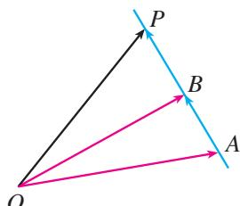

> [!faq]- 高中必修 第二册·人教A版数学
> 解：因为 $\overrightarrow{AP}=t\overrightarrow{AB}$ ,
>
> 
>
> 所以 $\overrightarrow{OP} = \overrightarrow{OA} +\overrightarrow{AP}$ $= \overrightarrow{OA} +t\overrightarrow{AB}$ $= \overrightarrow{OA} +t(\overrightarrow{OB} -\overrightarrow{OA})$ $= \overrightarrow{OA} +t\overrightarrow{OB} -t\overrightarrow{OA}$ $= (1 - t)\overrightarrow{OA} +t\overrightarrow{OB}.$
>
> 图6.3-4
>
> ?
>
> 观察 $\overrightarrow{OP} = (1 - t)\overrightarrow{OA} +$ $t\overrightarrow{OB}$ ，你有什么发现？
