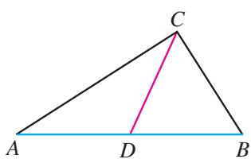
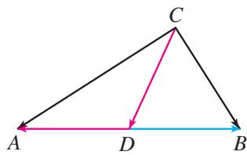

分析：由平面向量基本定理可知，任一向量都可由同一个基底表示.本题可取 $\{\overrightarrow{CD},\overrightarrow{DA}\}$ 为基底，用它表示 $\overrightarrow{CA}$ $\overrightarrow{CB}$ .证明 $\overrightarrow{CA}\cdot \overrightarrow{CB} = 0$ ，可得 $\overrightarrow{CA}\bot \overrightarrow{CB}$ ，从而证得△ABC是

  
图6.3-5

直角三角形.

证明：如图6.3-6，设 $\overrightarrow{CD} = a$ ， $\overrightarrow{DA} = b$ ，则 $\overrightarrow{CA} = a + b$ $\overrightarrow{DB} = -b$ ，于是 $\overrightarrow{CB} = a - b.$

$$
\overrightarrow {C A} \cdot \overrightarrow {C B} = (\boldsymbol {a} + \boldsymbol {b}) \cdot (\boldsymbol {a} - \boldsymbol {b}) = \boldsymbol {a} ^ {2} - \boldsymbol {b} ^ {2}.
$$

  
图6.3-6

因为 $CD=\frac{1}{2}AB$ ,

所以 $CD = DA$

因为 $a^{2}=CD^{2}$ ， $b^{2}=DA^{2}$ ，

所以 $\overrightarrow{CA} \cdot \overrightarrow{CB} = 0.$

因此 $CA \perp CB$ .

于是 $\triangle ABC$ 是直角三角形.

向量的数量积是否为零，是判断相应的两条线段（或直线）是否垂直的重要方法之一.

对应题目：[Q070000000445](../Q070000000445.md)

> 来源：高中必修 第二册·人教A版数学
