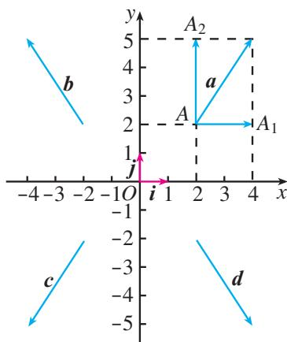

> [!faq]- 高中必修 第二册·人教A版数学
> 解：由图6.3-10可知， $a = \overrightarrow{AA_1} +\overrightarrow{AA_2} = 2i + 3j$
>
> 所以 $a=(2,3)$ .
>
> 同理，
>
> $$
> \boldsymbol {b} = - 2 \boldsymbol {i} + 3 \boldsymbol {j} = (- 2, 3),
> $$
>
> $$
> \boldsymbol {c} = - 2 \boldsymbol {i} - 3 \boldsymbol {j} = (- 2, - 3),
> $$
>
> $$
> \boldsymbol {d} = 2 \boldsymbol {i} - 3 \boldsymbol {j} = (2, - 3).
> $$
>
> 
> 图6.3-10
