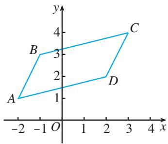
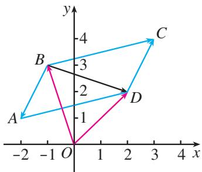

> [!faq]- 高中必修 第二册·人教A版数学
> 解法 1：如图 6.3-13，设顶点 D 的坐标为 $(x, y)$ .
>
> 因为 $\overrightarrow{AB}=(-1-(-2),3-1)=(1,2)$ , $\overrightarrow{DC}=(3-x,4-y)$ ,
>
> 又 $\overrightarrow{AB} = \overrightarrow{DC}$
>
> 图6.3-12
> 
>
> 所以 $(1, 2)=(3-x, 4-y)$ .
>
> 即 $\left\{ \begin{array}{l} 1 = 3 - x, \\ 2 = 4 - y, \end{array} \right.$ 解得 $\left\{ \begin{array}{l} x = 2, \\ y = 2. \end{array} \right.$
>
> 所以顶点 D 的坐标为 $(2, 2)$ .
>
> 图6.3-13
> 
> 图6.3-14
>
> 而
>
> $$
> \begin{array}{r l} \overrightarrow {O D} & = \overrightarrow {O B} + \overrightarrow {B D} \\ & = (- 1, 3) + (3, - 1) \\ & = (2, 2). \end{array}
> $$
>
> ?
>
> 你能比较一下两种解法在思想方法上的异同点吗？
>
> 所以顶点 D 的坐标为 $(2, 2)$ .
