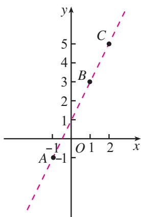

> [!faq]- 高中必修 第二册·人教A版数学
> 解：在平面直角坐标系中作出 A, B, C 三点（图 6.3-15）. 观察图形，我们猜想 A, B, C 三点共线. 下面来证明.
>
> 因为 $\overrightarrow{AB}=(1-(-1),3-(-1))=(2,4)$ , $\overrightarrow{AC}=(2-(-1),5-(-1))=(3,6)$ ,
>
> 又 $2 \times 6 - 4 \times 3 = 0$
>
> 所以 $\overrightarrow{AB} \parallel \overrightarrow{AC}.$
>
> 又 直线 $AB$ ，直线 $AC$ 有公共点 $A$
>
> 
> 图6.3-15
>
> 所以 A, B, C 三点共线.
