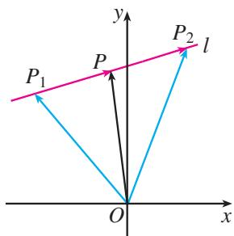
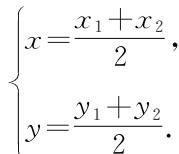
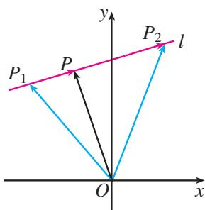
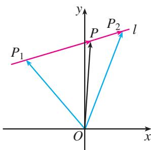

> [!faq]- 高中必修 第二册·人教A版数学
> 解：（1）如图6.3-16，由向量的线性运算可知
>
> $$
> \overrightarrow {O P} = \frac {1}{2} (\overrightarrow {O P _ {1}} + \overrightarrow {O P _ {2}}) = \left(\frac {x _ {1} + x _ {2}}{2}, \frac {y _ {1} + y _ {2}}{2}\right).
> $$
>
> 所以，点 P 的坐标是 $\left(\frac{x_{1}+x_{2}}{2}, \frac{y_{1}+y_{2}}{2}\right)$ .
>
> 若点 $P_{1}$ ， $P_{2}$ 的坐标分别为 $(x_{1},y_{1})$ ， $(x_{2},$ $y_{2})$ ，线段 $P_{1}P_{2}$ 的中点 $P$ 的坐标为 $(x,y)$ ，则
>
> 
> 图6.3-16
>
> 
>
> 此公式为线段 $P_{1}P_{2}$ 的中点坐标公式.
>
> （2）如图6.3-17，当点 $P$ 是线段 $P_{1}P_{2}$ 的一个三等分点时，有两种情况，即 $\overrightarrow{P_1P} = \frac{1}{2}\overrightarrow{PP_2}$ 或 $\overrightarrow{P_1P} = 2\overrightarrow{PP_2}$ .
>
> 如果 $\overrightarrow{P_1P} = \frac{1}{2}\overrightarrow{PP_2}$ （图6.3-17(1))，那么
>
> $$
> \begin{array}{r l} \overrightarrow {O P} & = \overrightarrow {O P _ {1}} + \overrightarrow {P _ {1} P} = \overrightarrow {O P _ {1}} + \frac {1}{3} \overrightarrow {P _ {1} P _ {2}} \\ & = \overrightarrow {O P _ {1}} + \frac {1}{3} (\overrightarrow {O P _ {2}} - \overrightarrow {O P _ {1}}) = \frac {2}{3} \overrightarrow {O P _ {1}} + \frac {1}{3} \overrightarrow {O P _ {2}} \\ & = \left(\frac {2 x _ {1} + x _ {2}}{3}, \frac {2 y _ {1} + y _ {2}}{3}\right), \end{array}
> $$
>
> 即点 P 的坐标是 $\left(\frac{2x_{1}+x_{2}}{3}, \frac{2y_{1}+y_{2}}{3}\right)$ .
>
> 
> (1)
>
> 图6.3-17
> 
> (2)
>
> 同理，如果 $\overrightarrow{P_1P} = 2\overrightarrow{PP_2}$ （图6.3-17(2))，那么点 $P$ 的坐标是 $\left(\frac{x_1 + 2x_2}{3},\frac{y_1 + 2y_2}{3}\right)$ .
