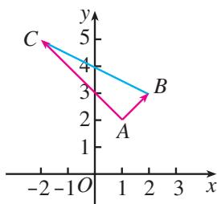

解：如图 6.3-19，在平面直角坐标系中画出点 A，B，C，我们发现 $\triangle ABC$ 是直角三角形。证明如下。

因为 $\overrightarrow{AB}=(2-1,3-2)=(1,1)$ ,

$$
\overrightarrow {A C} = (- 2 - 1, 5 - 2) = (- 3, 3),
$$

图6.3-19

所以 $\overrightarrow{AB} \cdot \overrightarrow{AC} = 1 \times (-3) + 1 \times 3 = 0.$

于是 $\overrightarrow{AB} \perp \overrightarrow{AC}.$

因此， $\triangle ABC$ 是直角三角形.

设 $a, b$ 都是非零向量， $a = (x_1, y_1)$ ， $b = (x_2, y_2)$ ， $\theta$ 是 $a$ 与 $b$ 的夹角，根据向量数量积的定义及坐标表示可得

$$
\cos \theta = \frac {\boldsymbol {a} \cdot \boldsymbol {b}}{| \boldsymbol {a} | | \boldsymbol {b} |} = \frac {x _ {1} x _ {2} + y _ {1} y _ {2}}{\sqrt {x _ {1} ^ {2} + y _ {1} ^ {2}} \sqrt {x _ {2} ^ {2} + y _ {2} ^ {2}}}.
$$

对应题目：[Q070000000464](../Q070000000464.md)

> 来源：高中必修 第二册·人教A版数学
