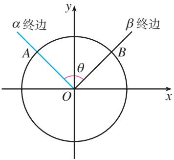
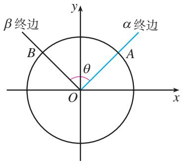

证明：如图6.3-20，在平面直角坐标系 $Oxy$ 内作单位圆 $O$ ，以 $x$ 轴的非负半轴为始边作角 $\alpha$ ， $\beta$ ，它们的终边与单位圆 $O$ 的交点分别为 $A$ ， $B$ ．则

$$
\overrightarrow {O A} = (\cos \alpha , \sin \alpha), \overrightarrow {O B} = (\cos \beta , \sin \beta).
$$

  
(1)

  
(2)  
图6.3-20

由向量数量积的坐标表示，有

$$
\overrightarrow {O A} \cdot \overrightarrow {O B} = \cos \alpha \cos \beta + \sin \alpha \sin \beta .
$$

设 $\overrightarrow{OA}$ 与 $\overrightarrow{OB}$ 的夹角为 $\theta$ ，则

$$
\overrightarrow {O A} \cdot \overrightarrow {O B} = | \overrightarrow {O A} | | \overrightarrow {O B} | \cos \theta = \cos \theta .
$$

所以

$$
\cos \theta = \cos \alpha \cos \beta + \sin \alpha \sin \beta .
$$

另一方面，由图6.3-20（1）可知， $\alpha = 2k\pi +\beta +\theta$ ；由图6.3-20（2）可知， $\alpha =$ $2k\pi +\beta -\theta .$ 于是 $\alpha -\beta = 2k\pi \pm \theta$ ， $k\in \mathbf{Z}$ 所以

$$
\cos (\alpha - \beta) = \cos \theta .
$$

于是

$$
\cos (\alpha - \beta) = \cos \alpha \cos \beta + \sin \alpha \sin \beta .
$$

运用向量工具进行探索，过程多么简洁啊！

对应题目：[Q070000000466](../Q070000000466.md)

> 来源：高中必修 第二册·人教A版数学
