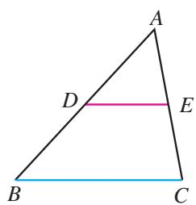
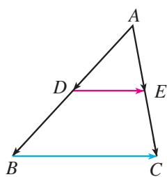

分析：初中证明过这个结论时要加辅助线，有一定难度.如果用向量方法证明这个结论，可以取 $\{\overrightarrow{AB},\overrightarrow{AC}\}$ 为基底，用 $\overrightarrow{AB},\overrightarrow{AC}$ 表示 $\overrightarrow{DE},\overrightarrow{BC}$ ，证明 $\overrightarrow{DE} = \frac{1}{2}\overrightarrow{BC}$ 即可.

  
图6.4-1

证明：如图6.4-2，因为 $DE$ 是 $\triangle ABC$ 的中位线，所以

$$
\overrightarrow {A D} = \frac {1}{2} \overrightarrow {A B}, \overrightarrow {A E} = \frac {1}{2} \overrightarrow {A C}.
$$

从而 $\overrightarrow{DE} = \overrightarrow{AE} -\overrightarrow{AD} = \frac{1}{2}\overrightarrow{AC} -\frac{1}{2}\overrightarrow{AB} = \frac{1}{2} (\overrightarrow{AC} -\overrightarrow{AB}).$ 又 $\overrightarrow{BC} = \overrightarrow{AC} -\overrightarrow{AB},$

所以 $\overrightarrow{DE}=\frac{1}{2}\overrightarrow{BC}.$

  
图6.4-2

于是 $DE \parallel BC, DE = \frac{1}{2} BC.$

平面几何经常涉及距离（线段长度）和角度问题，而平面向量的运算，特别是数量积主要涉及向量的模以及向量之间的夹角，因此我们可以用向量方法解决某些几何问题。用向量方法解决几何问题时，通常先用向量表示相应的点、线段、夹角等几何元素，然后通过向量的运算来研究点、线段等元素之间的关系，最后再把运算结果“翻译”成几何关系，便得到几何问题的结论。

用向量方法解决平面几何问题的“三步曲”：

（1）建立平面几何与向量的联系，用向量表示问题中涉及的几何元素，将平面几何问题转化为向量问题；

（2）通过向量运算，研究几何元素之间的关系，如距离、夹角等问题；

(3) 把运算结果 “翻译” 成几何关系.

对应题目：[Q070000000486](../Q070000000486.md)

> 来源：高中必修 第二册·人教A版数学
