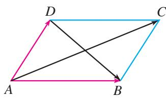

> [!faq]- 高中必修 第二册·人教A版数学
> 分析：平行四边形中与两条对角线对应的向量恰是与两条邻边对应的两个向量的和与差，我们可以通过向量运算来探索它们的模之间的关系.
>
> 解：第一步，建立平面几何与向量的联系，用向量表示问题中的几何元素，将平面几何问题转化为向量问题：
>
> 如图6.4-4，取 $\{\overrightarrow{AB},\overrightarrow{AD}\}$ 为基底，设 $\overrightarrow{AB} = a$ ， $\overrightarrow{AD} = b$ ，则
>
> 图6.4-3
> 
> 图6.4-4
>
> $$
> \overrightarrow {A C} = \boldsymbol {a} + \boldsymbol {b}, \overrightarrow {D B} = \boldsymbol {a} - \boldsymbol {b}.
> $$
>
> 第二步，通过向量运算，研究几何元素之间的关系：
>
> $$
> \overrightarrow {A C ^ {2}} = (\boldsymbol {a} + \boldsymbol {b}) ^ {2} = \boldsymbol {a} ^ {2} + 2 \boldsymbol {a} \cdot \boldsymbol {b} + \boldsymbol {b} ^ {2},
> $$
>
> $$
> \overrightarrow {D B ^ {2}} = (a - b) ^ {2} = a ^ {2} - 2 a \cdot b + b ^ {2}.
> $$
>
> 上面两式相加，得 $\overrightarrow{AC^{2}} + \overrightarrow{DB^{2}} = 2(a^{2} + b^{2})$ .
>
> 第三步，把运算结果“翻译”成几何关系：
>
> 你能用自然语言叙述这个关系式的意义吗？
>
> $$
> A C ^ {2} + B D ^ {2} = 2 (A B ^ {2} + A D ^ {2}).
> $$
