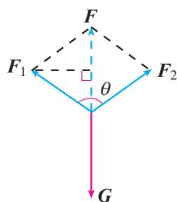

分析：不妨以两人共提旅行包为例，只要研究清楚两个拉力的合力、旅行包所受的重力以及两个拉力的夹角三者之间的关系，就可以获得问题的数学解释.

解：先来看共提旅行包的情况. 如图 6.4-5，设作用在旅行包上的两个拉力分别为 $F_{1}$ ， $F_{2}$ ，为方便起见，我们不妨设 $\left|F_{1}\right|=\left|F_{2}\right|$ . 另设 $F_{1}$ ， $F_{2}$ 的夹角为 $\theta$ ，旅行包所受的重力为 G.

由向量的平行四边形法则、力的平衡以及直角三角形的知识，可以知道

$$
\left| \boldsymbol {F} _ {1} \right| = \frac {\left| \boldsymbol {G} \right|}{2 \cos \frac {\theta}{2}}.
$$

这里， $|G|$ 为定值. 分析上面的式子，我们发现，当 $\theta$ 由0逐渐变大到 $\pi$ 时， $\frac{\theta}{2}$ 由0逐渐变大到 $\frac{\pi}{2}$ ， $\cos \frac{\theta}{2}$ 的值由大逐渐变小，此时 $|F_1|$ 由小

图6.4-5

逐渐变大；反之，当 $\theta$ 由 $\pi$ 逐渐变小到0时， $\frac{\theta}{2}$ 由 $\frac{\pi}{2}$ 逐渐变小到0， $\cos \frac{\theta}{2}$ 的值由小逐渐变大，此时 $|F_1|$ 由大逐渐变小。这就是说， $F_1, F_2$ 之间的夹角越大越费力，夹角越小越省力。

同理，在单杠上做引体向上运动，两臂的夹角越小越省力.

对应题目：[Q070000000491](../Q070000000491.md)

> 来源：高中必修 第二册·人教A版数学
