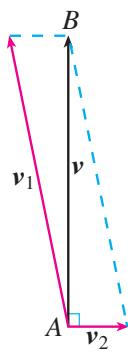

> [!faq]- 高中必修 第二册·人教A版数学
> 分析：如果水是静止的，那么船只要取垂直于河岸的方向行驶，就能使航程最短，此时所用时间也是最短的。考虑到水的流速，要使航程最短，船的速度与水流速度的合速度 v 必须垂直于河岸。
>
> 图6.4-6
>
> 解：设点 B 是河对岸一点，AB 与河岸垂直，那么当这艘船实际沿着 AB 方向行驶时，船的航程最短.
>
> 如图6.4-7，设 $\pmb {v} = \pmb{v}_1 + \pmb{v}_2$ ，则
>
> $$
> | \boldsymbol {v} | = \sqrt {\left| \boldsymbol {v} _ {1} \right| ^ {2} - \left| \boldsymbol {v} _ {2} \right| ^ {2}} = \sqrt {9 6} (\mathrm{km/h}).
> $$
>
> 此时，船的航行时间
>
> $$
> t = \frac {d}{| \boldsymbol {v} |} = \frac {0 . 5}{\sqrt {9 6}} \times 6 0 \approx 3. 1 (\min).
> $$
>
> 
> 图6.4-7
>
> 所以，当航程最短时，这艘船行驶完全程需要 3.1 min.
