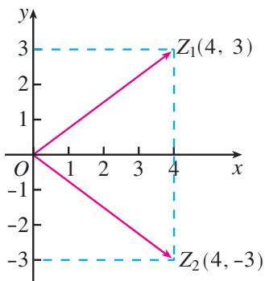

解：（1）如图7.1-4，复数 $z_{1}$ ， $z_{2}$ 对应的点分别为 $Z_{1}$ ， $Z_{2}$ ，对应的向量分别为 $\overrightarrow{OZ_1}$ ， $\overrightarrow{OZ_2}$

  
图7.1-4

?

点 $Z_{1}$ ， $Z_{2}$ 有怎样的关系？

(2) $|z_1| = |4 + 3\mathrm{i}| = \sqrt{4^2 + 3^2} = 5,$

$$
\left| z _ {2} \right| = \left| 4 - 3 \mathrm{i} \right| = \sqrt {4 ^ {2} + (- 3) ^ {2}} = 5.
$$

所以 $|z_1| = |z_2|$

一般地，当两个复数的实部相等，虚部互为相反数时，这两个复数叫做互为共轭复数（conjugate complex number）。虚部不等于0的两个共轭复数也叫做共轭虚数。复数 $z$ 的共轭复数用 $\bar{z}$ 表示，即如果 $z = a + bi$ ，那么 $\bar{z} = a - bi$ 。

对应题目：[Q070000000563](../Q070000000563.md)

> 来源：高中必修 第二册·人教A版数学
