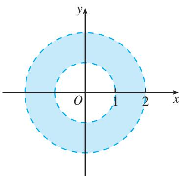

> [!faq]- 高中必修 第二册·人教A版数学
> 解：（1）由 $|z| = 1$ 得，向量 $\overrightarrow{OZ}$ 的模等于1，所以满足条件 $|z| = 1$ 的点 $Z$ 的集合是以原点 $O$ 为圆心，以1为半径的圆.
>
> (2) 不等式 $1 < |z| < 2$ 可化为不等式 $\left\{ \begin{array}{l} |z| < 2, \\ |z| > 1. \end{array} \right.$
>
> 不等式 $|z| < 2$ 的解集是圆 $|z| = 2$ 的内部所有的点组成的集合，不等式 $|z| > 1$ 的解集是圆 $|z| = 1$ 外部所有的点组成的集合，这两个集合的交集，就是上述不等式组的解集，也就是满足条件 $1 < |z| < 2$ 的点 $Z$ 的集合。容易看出，所求的集合是以原点 $O$ 为圆心，以1及2为半径的两个圆所夹的圆环，但不包括圆环的边界（图7.1-5）。
>
> 
> 图7.1-5
