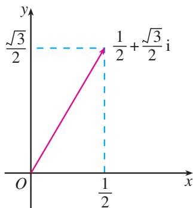
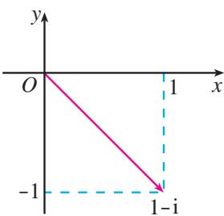

> [!faq]- 高中必修 第二册·人教A版数学
> 分析：只要确定复数的模和一个辐角，就能将复数的代数形式转化为三角形式.
>
> 解：（1）复数 $\frac{1}{2} +\frac{\sqrt{3}}{2}\mathrm{i}$ 对应的向量如图7.3-2所示，则
>
> $$
> r = \sqrt {\left(\frac {1}{2}\right) ^ {2} + \left(\frac {\sqrt {3}}{2}\right) ^ {2}} = 1, \cos \theta = \frac {1}{2}.
> $$
>
> 
> 图7.3-2
>
> 因为与 $\frac{1}{2} +\frac{\sqrt{3}}{2}\mathrm{i}$ 对应的点在第一象限，所以 $\arg \left(\frac{1}{2} +\frac{\sqrt{3}}{2}\mathrm{i}\right) = \frac{\pi}{3}.$
>
> 于是 $\frac{1}{2} +\frac{\sqrt{3}}{2}\mathrm{i} = \cos \frac{\pi}{3} +\mathrm{i}\sin \frac{\pi}{3}.$
>
> (2) 复数 1-i 对应的向量如图 7.3-3 所示，则
>
> $$
> r = \sqrt {1 ^ {2} + (- 1) ^ {2}} = \sqrt {2}, \cos \theta = \frac {1}{\sqrt {2}} = \frac {\sqrt {2}}{2}.
> $$
>
> 因为与 1-i 对应的点在第四象限，所以 $\arg(1-i)=\frac{7\pi}{4}$ .
>
> 
>
> 于是 $1 - \mathrm{i} = \sqrt{2}\left(\cos \frac{7\pi}{4} +\mathrm{i}\sin \frac{7\pi}{4}\right).$
>
> 图7.3-3
>
> 当然，把一个复数表示成三角形式时，辐角 $\theta$ 不一定取主值。例如 $\sqrt{2}\left[\cos\left(-\frac{\pi}{4}\right)+\mathrm{i}\sin\left(-\frac{\pi}{4}\right)\right]$ 也是 $1-\mathrm{i}$ 的三角形式。
