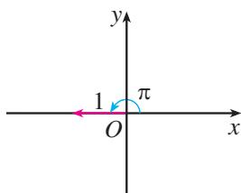
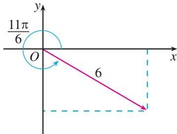

> [!faq]- 高中必修 第二册·人教A版数学
> 解：（1）复数 $\cos \pi + \mathrm{i}\sin \pi$ 的模 $r = 1$ ，一个辐角 $\theta = \pi$ ，对应的向量如图7.3-4所示。所以
>
> 
>
> $$
> \cos \pi + \mathrm{i} \sin \pi = - 1 + 0 \mathrm{i} = - 1.
> $$
>
> (2) 复数 $6\left(\cos \frac{11\pi}{6} + \mathrm{i}\sin \frac{11\pi}{6}\right)$ 的模 $r = 6$ ，一个辐角 $\theta = \frac{11\pi}{6}$ ，对应的向量如图7.3-5所示。所以 $6\left(\cos \frac{11\pi}{6} + \mathrm{i}\sin \frac{11\pi}{6}\right) = 6\cos \frac{11\pi}{6} + (6\sin \frac{11\pi}{6})\mathrm{i}$ $= 6 \times \frac{\sqrt{3}}{2} + 6 \times \left(-\frac{1}{2}\right)\mathrm{i}$ $= 3\sqrt{3} - 3\mathrm{i}$ 。
>
> 图7.3-4
> 
> 图7.3-5
