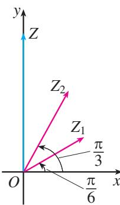

$$
\begin{array}{r l} \text {解:} z _ {1} z _ {2} & = \frac {3}{2} \big (\cos \frac {\pi}{6} + \mathrm{i} \sin \frac {\pi}{6} \big) \times 2 \big (\cos \frac {\pi}{3} + \mathrm{i} \sin \frac {\pi}{3} \big) \\ & = \frac {3}{2} \times 2 \Big [ \cos \big (\frac {\pi}{6} + \frac {\pi}{3} \big) + \mathrm{i} \sin \big (\frac {\pi}{6} + \frac {\pi}{3} \big) \Big ] \\ & = 3 \big (\cos \frac {\pi}{2} + \mathrm{i} \sin \frac {\pi}{2} \big) \\ & = 3 \mathrm{i}. \end{array}
$$

当不要求把计算结果化为代数形式时，也可以用三角形式表示.

首先作与 $z_{1}$ ， $z_{2}$ 对应的向量 $\overrightarrow{OZ_1}$ ， $\overrightarrow{OZ_2}$ ，然后把向量 $\overrightarrow{OZ_1}$ 绕点 $O$ 按逆时针方向旋转 $\frac{\pi}{3}$ ，再将其长度伸长为原来的2倍，这样得到一个长度为3，辐角为 $\frac{\pi}{2}$ 的向量 $\overrightarrow{OZ}$ （图7.3-7). $\overrightarrow{OZ}$ 即为积 $z_{1}z_{2} = 3\mathrm{i}$ 所对应的向量.

  
图7.3-7

对应题目：[Q070000000608](../Q070000000608.md)

> 来源：高中必修 第二册·人教A版数学
