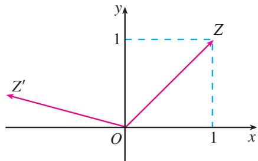

分析：根据复数乘法的几何意义，向量 $\overrightarrow{OZ'}$ 对应的复数是复数 $1 + \mathrm{i}$ 与 $z_0$ 的积，其中复数 $z_0$ 的模是1，辐角的主值是 $120^{\circ}$ .

  
图7.3-8

解：向量 $\overrightarrow{OZ'}$ 对应的复数为

$$
\begin{array}{r l} & (1 + \mathrm{i}) (\cos 1 2 0 ^ {\circ} + \mathrm{i} \sin 1 2 0 ^ {\circ}) \\ & = (1 + \mathrm{i}) \left(- \frac {1}{2} + \frac {\sqrt {3}}{2} \mathrm{i}\right) \\ & = \frac {- 1 - \sqrt {3}}{2} + \frac {\sqrt {3} - 1}{2} \mathrm{i}. \end{array}
$$

对应题目：[Q070000000609](../Q070000000609.md)

> 来源：高中必修 第二册·人教A版数学
