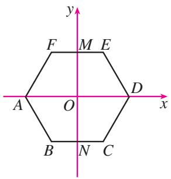
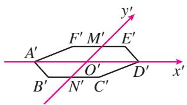
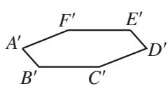
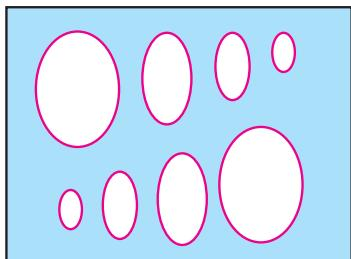

> [!faq]- 高中必修 第二册·人教A版数学
> 画法：（1）如图8.2-4(1)，在正六边形ABCDEF中，取AD所在直线为 $x$ 轴，AD的垂直平分线MN为y轴，两轴相交于点O。在图8.2-4(2）中，画相应的 $x^{\prime}$ 轴与 $y^{\prime}$ 轴，两轴相交于点 $O^{\prime}$ ，使 $\angle x'O'y' = 45^{\circ}$ 。
>
> 
> (1)
>
> 
> (2)
>
> 
> (3)
> 图8.2-4
>
> （2）在图8.2-4（2）中，以 $O^{\prime}$ 为中点，在 $x^{\prime}$ 轴上取 $A^{\prime}D^{\prime} = AD$ ，在 $y^\prime$ 轴上取 $M^{\prime}N^{\prime} = \frac{1}{2} MN$ .以点 $N^{\prime}$ 为中点，画 $B^{\prime}C^{\prime}$ 平行于 $x^{\prime}$ 轴，并且等于BC；再以 $M^{\prime}$ 为中点，画 $F^{\prime}E^{\prime}$ 平行于 $x^{\prime}$ 轴，并且等于FE.
>
> 在利用斜二测画法画直观图的过程中，x 轴和 y 轴起到了什么作用？
>
> （3）连接 $A^{\prime}B^{\prime}$ ， $C^{\prime}D^{\prime}$ ， $D^{\prime}E^{\prime}$ ， $F^{\prime}A^{\prime}$ ，并擦去辅助线 $x^{\prime}$ 轴和 $y^{\prime}$ 轴，便获得正六边形 ABCDEF 水平放置的直观图 $A^{\prime}B^{\prime}C^{\prime}D^{\prime}E^{\prime}F^{\prime}$ （图 8.2-4(3)).
>
> 画直观图时，除多边形外，还经常会遇到画圆的直观图的问题。生活的经验告诉我们，水平放置的圆看起来非常像椭圆，因此我们一般用椭圆作为圆的直观图。实际画图时常用如图8.2-5所示的椭圆模板。
>
> 
> 图8.2-5
>
> 在立体几何中，常用正等测画法画水平放置的圆.
