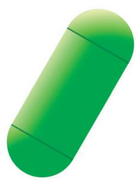

解：一个浮标的表面积为

$$
2 \pi \times 0. 1 5 \times 0. 6 + 4 \pi \times 0. 1 5 ^ {2} = 0. 8 4 7 8 (\mathrm{m} ^ {2}),
$$

所以给1000个这样的浮标涂防水漆约需涂料

图8.3-4

$$
0. 8 4 7 8 \times 0. 5 \times 1 0 0 0 = 4 2 3. 9 (\mathrm{kg}).
$$

对应题目：[Q070000000684](../Q070000000684.md)

> 来源：高中必修 第二册·人教A版数学
