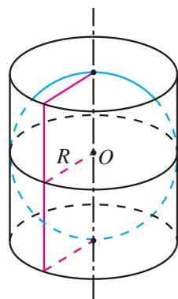

> [!faq]- 高中必修 第二册·人教A版数学
> 解：设球的半径为 R，则圆柱的底面半径为 R，高为 2R.
>
> $$
> \because \quad V _ {\text {球}} = \frac {4}{3} \pi R ^ {3}, V _ {\text {圆柱}} = \pi R ^ {2} \cdot 2 R = 2 \pi R ^ {3},
> $$
>
> $$
> \therefore V _ {\text {球}}: V _ {\text {圆柱}} = \frac {4}{3} \pi R ^ {3}: 2 \pi R ^ {3} = \frac {2}{3}.
> $$
>
> 
> 图8.3-6
>
> 本节我们学习了柱体、锥体、台体、球的表面积与体积的计算方法。在生产、生活中遇到的物体，往往形状比较复杂，但很多物体都可以看作由这些简单几何体组合而成的，它们的表面积与体积可以利用这些简单几何体的表面积与体积来计算。
