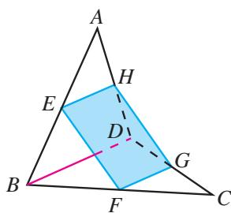

分析：要证明四边形 $EFGH$ 是平行四边形，只需证明它的一组对边平行且相等．而 $EH$ ， $FG$ 分别是 $\triangle ABD$ 和 $\triangle CBD$ 的中位线，从而它们都与 $BD$ 平行且等于 $BD$ 的一半．应用基本事实4，即可证明 $EH \perp FG$ .

  
图8.5-3

证明：连接 $BD$

∵ EH 是△ABD 的中位线，

∴ $EH \parallel BD$ ，且 $EH = \frac{1}{2} BD$ .

同理 $FG \parallel BD$ ，且 $FG = \frac{1}{2} BD$ .

$$
\therefore E H \underline {{\parallel}} F G.
$$

在本例中，如果再加上条件 $AC = BD$ ，那么四边形EFGH是什么图形？

∴ 四边形 EFGH 为平行四边形.

对应题目：[Q070000000719](../Q070000000719.md)

> 来源：高中必修 第二册·人教A版数学
