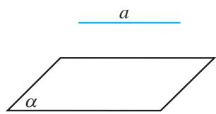
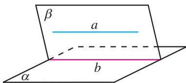

> [!faq]- 高中必修 第二册·人教A版数学
> 证明：连接 $BD$
>
> ∵ AE=EB, AF=FD,
>
> ∴ $EF \parallel BD.$
>
> 又 $EF \not\subset$ 平面 $BCD, BD \subset$ 平面 $BCD,$
>
> ∴ $EF \parallel$ 平面 BCD.
>
> 今后要证明一条直线与一个平面平行，只要在这个平面内找出一条与此直线平行的直线就可以了.
>
> 前面，我们利用平面内的直线与平面外的直线平行，得到了判定平面外的直线与此平面平行的方法，即得到了一条直线与平面平行的充分条件。反过来，如果一条直线与一个平面平行，能推出哪些结论呢？这就是要研究直线与平面平行的性质，也就是研究直线与平面平行的必要条件。
>
> 下面我们研究在直线 a 平行于平面 $\alpha$ 的条件下，直线 a 与平面 $\alpha$ 内的直线的位置关系.
>
> 如图8.5-8，由定义，如果直线 $a / /$ 平面 $\alpha$ ，那么 $a$ 与 $\alpha$ 无公共点，即 $a$ 与 $\alpha$ 内的任何直线都无公共点．这样，平面 $\alpha$ 内的直线与平面 $\alpha$ 外的直线 $a$ 只能是异面或者平行的关系.那么，在什么条件下，平面 $\alpha$ 内的直线与直线 $a$ 平行呢？下面我们来分析一下：
>
> 
> 图8.5-8
>
> 假设 $a$ 与 $\alpha$ 内的直线 $b$ 平行，那么由基本事实的推论3，过直线 $a$ ， $b$ 有唯一的平面 $\beta$ 。这样，我们可以把直线 $b$ 看作过直线 $a$ 的平面 $\beta$ 与平面 $\alpha$ 的交线。于是可得如下结论：过直线 $a$ 的平面 $\beta$ 与平面 $\alpha$ 相交于 $b$ ，则 $a // b$
>
> 下面，我们来证明这一结论.
>
> 如图 8.5-9，已知 $a \parallel \alpha, a \subset \beta, \alpha \cap \beta = b.$
>
> 求证： $a \parallel b$ .
>
> 证明：∵ $\alpha\cap\beta=b$
>
> 
>
> $\therefore b\subset\alpha.$
>
> 又 $a / / \alpha$
>
> 图8.5-9
>
> ∴ a 与 b 无公共点.
>
> 又 $a\subset \beta ,b\subset \beta ,$
>
> ∴ $a \parallel b.$
>
> 这样，我们就得到了直线与平面平行的性质定理：
