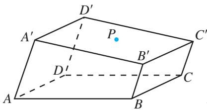
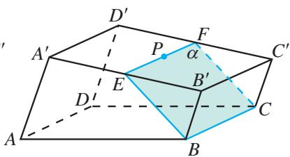

分析：要经过面 $A^{\prime}C^{\prime}$ 内的一点 $P$ 和棱 $BC$ 将木料锯开，实际上是经过 $BC$ 及 $BC$ 外一点 $P$ 作截面，也就需要找出所作的截面与相关平面的交线。我们可以依据直线与平面平行的性质定理、基本事实4和推论1画出所需要的线段。

  
(1)

  
(2)  
图8.5-10

解：（1）如图8.5-10(2)，在平面 $A^{\prime}C^{\prime}$ 内，过点 $P$ 作直线 $EF$ ，使 $EF / / B^{\prime}C^{\prime}$ ，并分别交棱 $A^{\prime}B^{\prime}$ ， $D^{\prime}C^{\prime}$ 于点 $E$ ， $F$ 。连接 $BE$ ， $CF$ ，则 $EF$ ， $BE$ ， $CF$ 就是应画的线。

（2）因为棱 $BC$ 平行于平面 $A^{\prime}C^{\prime}$ ，平面 $BC^{\prime}$ 与平面 $A^{\prime}C^{\prime}$ 相交于 $B^{\prime}C^{\prime}$ ，所以 $BC \parallel B^{\prime}C^{\prime}$ .由（1）知， $EF \parallel B^{\prime}C^{\prime}$ ，所以 $EF \parallel BC$ .而 $BC$ 在平面 $AC$ 内， $EF$ 在平面 $AC$ 外，所以 $EF \parallel$ 平面 $AC$

显然，BE，CF 都与平面 AC 相交.

对应题目：[Q070000000725](../Q070000000725.md)

> 来源：高中必修 第二册·人教A版数学
