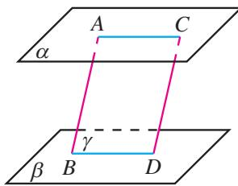

> [!faq]- 高中必修 第二册·人教A版数学
> 证明：过平行线 AB，CD 作平面 $\gamma$ ，与平面 $\alpha$ 和 $\beta$ 分别相交于 AC 和 BD.
>
> 
> 图8.5-19
>
> $\because \alpha // \beta,$
>
> ∴ BD∥AC.
>
> 又 $AB \parallel CD$
>
> ∴ 四边形 ABDC 是平行四边形.
>
> ∴ AB = CD.
>
> 从本节的讨论可以看到，由直线与直线平行可以判定直线与平面平行；由直线与平面平行的性质可以得到直线与直线平行；由直线与平面平行可以判定平面与平面平行；由平面与平面平行的定义及性质可以得到直线与平面平行、直线与直线平行。这种直线、平面之间位置关系的相互转化是立体几何中的重要思想方法。
>
> 
