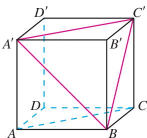

解：（1）棱 AB，BC，CD，DA， $A^{\prime}B^{\prime}$ ， $B^{\prime}C^{\prime}$ ， $C^{\prime}D^{\prime}$ ， $D^{\prime}A^{\prime}$ 所在直线分别与直线 $AA^{\prime}$ 垂直.

图8.6-3

(2) 因为 $ABCD - A'B'C'D'$ 是正方体，所以 $BB' \parallel CC'$ ，因此 $\angle A'BB'$ 为直线 $BA'$ 与 $CC'$ 所成的角。又因为 $\angle A'BB' = 45^\circ$ ，所以直线 $BA'$ 与 $CC'$ 所成的角等于 $45^\circ$ 。

（3）如图8.6-4，连接 $A^{\prime}C^{\prime}$ .因为ABCD- $A^{\prime}B^{\prime}C^{\prime}D^{\prime}$ 是正方体，所以 $AA^{\prime}\bot CC^{\prime}$ 从而四边形 $AA^{\prime}C^{\prime}C$ 是平行四边形，所以 $AC / / A^{\prime}C^{\prime}$ 于是 $\angle BA^{\prime}C^{\prime}$ 为异面直线 $BA^{\prime}$ 与 $AC$ 所成的角.

连接 $BC'$ ，易知 $\triangle A'BC'$ 是等边三角形，所以 $\angle BA'C' = 60^\circ$ 。从而异面直线 $BA'$ 与 $AC$ 所成的角等于 $60^\circ$ 。

  
图8.6-4

对应题目：[Q070000000751](../Q070000000751.md)

> 来源：高中必修 第二册·人教A版数学
