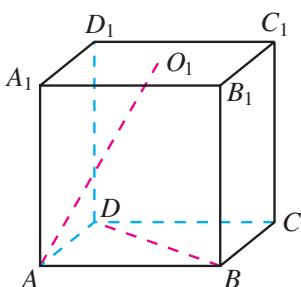
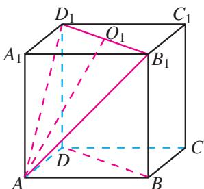
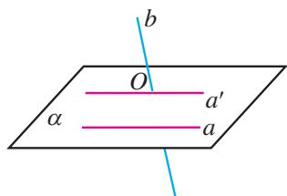

分析：要证明 $AO_{1} \perp BD$ ，应先构造直线 $AO_{1}$ 与 $BD$ 所成的角，若能证明这个角是直角，即得 $AO_{1} \perp BD$ .

  
(1)

  
图8.6-5  
(2)

证明：如图 8.6-5（2），连接 $B_{1}D_{1}$

∵ $ABCD-A_{1}B_{1}C_{1}D_{1}$ 是正方体，

$\therefore BB_{1}\perp DD_{1}.$

∴ 四边形 $BB_{1}D_{1}D$ 是平行四边形.

$$
\therefore \quad B _ {1} D _ {1} / / B D.
$$

∴ 直线 $AO_{1}$ 与 $B_{1}D_{1}$ 所成的角即为直线 $AO_{1}$ 与 BD 所成的角.

连接 $AB_{1}$ ， $AD_{1}$ ，易证 $AB_{1}=AD_{1}$ .

又 $O_{1}$ 为底面 $A_{1}B_{1}C_{1}D_{1}$ 的中心，

∴ $O_{1}$ 为 $B_{1}D_{1}$ 的中点，

$$
\therefore A O _ {1} \perp B _ {1} D _ {1}
$$

$$
\therefore A O _ {1} \perp B D.
$$

从例 1 与例 2 的解答可以看到，为了简便，求异面直线 a，b 所成的角时，点 O 常取在两条异面直线中的一条上。例如取在直线 b 上，然后经过点 O 作直线 $a' \parallel a$ ，那么 $a'$ 与 b 所成的角就是异面直线 a 与 b 所成的角（图 8.6-6）。

图8.6-6

对应题目：[Q070000000752](../Q070000000752.md)

> 来源：高中必修 第二册·人教A版数学
