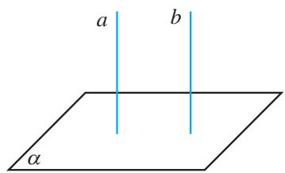
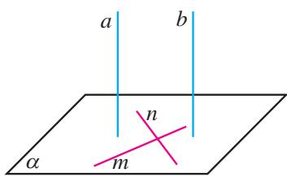
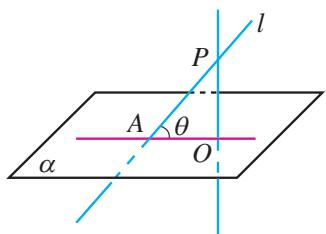
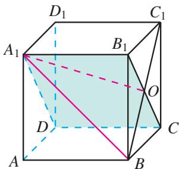

> [!faq]- 高中必修 第二册·人教A版数学
> 分析：要证明直线 $b \perp \alpha$ ，根据直线与平面垂直的判定定理可知，只需证明直线 $b$ 垂直于平面 $\alpha$ 内的两条相交直线即可.
>
> 
> 图8.6-12
>
> 
> 图8.6-13
>
> 证明：如图8.6-13，在平面 $\alpha$ 内取两条相交直线 $m, n$ .
>
> $$
> \because
> $$
>
> $$
> a \perp \alpha
> $$
>
> $$
> \therefore a \perp m, a \perp n.
> $$
>
> $$
> \because \quad b \parallel a,
> $$
>
> $$
> \therefore b \perp m, b \perp n.
> $$
>
> 又 $m \subset \alpha, n \subset \alpha, m, n$ 是两条相交直线，
>
> 你能用直线与平面垂直的定义证明这个结论吗？
>
> 如图 8.6-14，一条直线 l 与一个平面 $\alpha$ 相交，但不与这个平面垂直，这条直线叫做这个平面的斜线，斜线和平面的交点 A 叫做斜足。过斜线上斜足以外的一点 P 向平面 $\alpha$ 引垂线 PO，过垂足 O 和斜足 A 的直线 AO 叫做斜线在这个平面上的射影。平面的一条斜线和它在平面上的射影所成的角，叫做这条直线和这个平面所成的角。
>
> 
> 图8.6-14
>
> 如果 AB 是平面 $\alpha$ 内的任意一条不与直线 AO 重合的直线，那么直线 PA 与直线 AB 所成的角和直线 PA 与这个平面所成的角的大小关系是什么？
>
> 一条直线垂直于平面，我们说它们所成的角是 $90^{\circ}$ ；一条直线和平面平行，或在平面内，我们说它们所成的角是 $0^{\circ}$ 。直线与平面所成的角 $\theta$ 的取值范围是 $0^{\circ} \leqslant \theta \leqslant 90^{\circ}$ 。
>
> 例4如图8.6-15，在正方体 $ABCD - A_{1}B_{1}C_{1}D_{1}$ 中，求直线 $A_{1}B$ 和平面 $A_{1}DCB_{1}$ 所成的角.
>
> 分析：关键是找出直线 $A_{1}B$ 在平面 $A_{1}DCB_{1}$ 上的射影.
>
> 解：连接 $BC_{1}$ ， $BC_{1}$ 与 $B_{1}C$ 相交于点 $O$ ，连接 $A_{1}O$ 。设正方体的棱长为 $a$ 。
>
> 
>
> $$
> \because A _ {1} B _ {1} \perp B _ {1} C _ {1}, A _ {1} B _ {1} \perp B _ {1} B, B _ {1} C _ {1} \cap B _ {1} B = B _ {1},
> $$
>
> ∴ $A_{1}B_{1} \perp$ 平面 $BCC_{1}B_{1}$ .
>
> 图8.6-15
>
> $$
> \therefore A _ {1} B _ {1} \perp B C _ {1}.
> $$
>
> 又 $BC_{1}\bot B_{1}C$
>
> ∴ $BC_{1} \perp$ 平面 $A_{1}DCB_{1}$ .
>
> ∴ $A_{1}O$ 为斜线 $A_{1}B$ 在平面 $A_{1}DCB_{1}$ 上的射影， $\angle BA_{1}O$ 为 $A_{1}B$ 和平面 $A_{1}DCB_{1}$ 所成的角.
>
> 在 Rt△A₁BO 中， $A_{1}B=\sqrt{2}a$ ， $BO=\frac{\sqrt{2}}{2}a$ ，
>
> $$
> \therefore B O = \frac {1}{2} A _ {1} B.
> $$
>
> $$
> \therefore \angle B A _ {1} O = 3 0 ^ {\circ}.
> $$
>
> ∴ 直线 $A_{1}B$ 和平面 $A_{1}DCB_{1}$ 所成的角为 $30^{\circ}$ .
