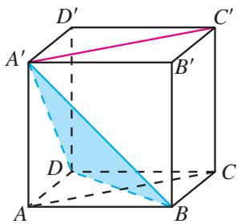

> [!faq]- 高中必修 第二册·人教A版数学
> 分析：要证平面 $A^{\prime}BD \perp$ 平面 $ACC^{\prime}A^{\prime}$ ，根据两个平面垂直的判定定理，只需证明平面 $A^{\prime}BD$ 经过平面 $ACC^{\prime}A^{\prime}$ 的一条垂线即可。这需要利用 $AC$ ， $BD$ 是正方形 $ABCD$ 的对角线。
>
> 
>
> 证明：∵ $ABCD-A'B'C'D'$ 是正方体，
>
> 图8.6-27
>
> ∴ $AA' \perp$ 平面 ABCD,
>
> ∴ $AA' \perp BD.$
>
> 又 $BD \perp AC, AA' \cap AC = A,$
>
> ∴ $BD \perp$ 平面 $ACC'A'$ ,
>
> ∴ 平面 $A^{\prime}BD \perp$ 平面 $ACC^{\prime}A^{\prime}$ .
