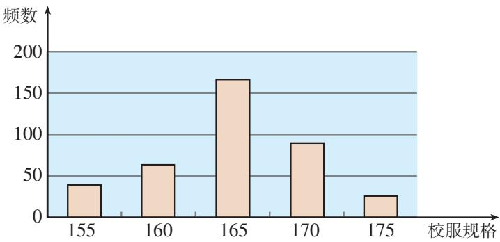

> [!faq]- 高中必修 第二册·人教A版数学
> 分析：虽然校服规格是用数字表示的，但它们事实上是几种不同的类别。对于这样的分类数据，用众数作为这组数据的代表比较合适。
>
> 解：为了更直观地观察数据的特征，我们用条形图来表示表中的数据（图 9.2-9）。可以发现，选择校服规格为“165”的女生的频数最高，所以用众数 165 作为该校高一年级女生校服的规格比较合适。
>
> 由于全国各地的高一年级女生的身高存在一定的差异，所以用一个学校的数据估计全国高一年级女生的校服规格不合理.
>
> 
> 图9.2-9
>
> 众数只利用了出现次数最多的那个值的信息。众数只能告诉我们它比其他值出现的次数多，但并未告诉我们它比别的数值多的程度。因此，众数只能传递数据中的信息的很少一部分，对极端值也不敏感。
>
> 一般地，对数值型数据（如用水量、身高、收入、产量等）集中趋势的描述，可以用平均数、中位数；而对分类型数据（如校服规格、性别、产品质量等级等）集中趋势的描述，可以用众数.
