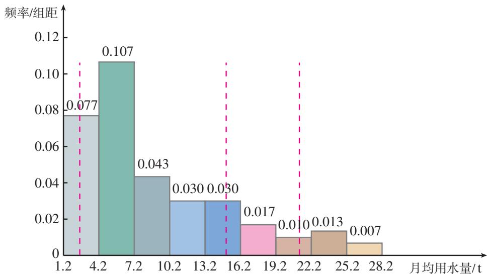

解：把男生样本记为 $x_{1}$ ， $x_{2}$ ，…， $x_{23}$ ，其平均数记为 $\overline{x}$ ，方差记为 $s_{x}^{2}$ ；把女生样本记为 $y_{1}$ ， $y_{2}$ ，…， $y_{27}$ ，其平均数记为 $\overline{y}$ ，方差记为 $s_{y}^{2}$ ；把总样本数据的平均数记为 $\overline{z}$ ，方差记为 $s^{2}$ .

根据方差的定义，总样本方差为

$$
s ^ {2} = \frac {1}{5 0} \left[ \sum_ {i = 1} ^ {2 3} \left(x _ {i} - \bar {z}\right) ^ {2} + \sum_ {j = 1} ^ {2 7} \left(y _ {j} - \bar {z}\right) ^ {2} \right]
$$

第九章 统计

$$
= \frac {1}{5 0} \left[ \sum_ {i = 1} ^ {2 3} \left(x _ {i} - \bar {x} + \bar {x} - \bar {z}\right) ^ {2} + \sum_ {j = 1} ^ {2 7} \left(y _ {j} - \bar {y} + \bar {y} - \bar {z}\right) ^ {2} \right].
$$

由 $\sum_{i=1}^{23}(x_i - \overline{x}) = \sum_{i=1}^{23} x_i - 23\overline{x} = 0$ ，可得

$$
\sum_ {i = 1} ^ {2 3} 2 (x _ {i} - \overline {{x}}) (\overline {{x}} - \overline {{z}}) = 2 (\overline {{x}} - \overline {{z}}) \sum_ {i = 1} ^ {2 3} (x _ {i} - \overline {{x}}) = 0.
$$

同理可得

$$
\sum_ {j = 1} ^ {2 7} 2 (y _ {j} - \overline {{y}}) (\overline {{y}} - \overline {{z}}) = 0.
$$

因此，

$$
\begin{array}{l} s ^ {2} = \frac {1}{5 0} \left[ \sum_ {i = 1} ^ {2 3} (x _ {i} - \overline {{x}}) ^ {2} + \sum_ {i = 1} ^ {2 3} (\overline {{x}} - \overline {{z}}) ^ {2} + \sum_ {j = 1} ^ {2 7} (y _ {j} - \overline {{y}}) ^ {2} + \sum_ {j = 1} ^ {2 7} (\overline {{y}} - \overline {{z}}) ^ {2} \right] \\ = \frac {1}{5 0} \left\{2 3 \left[ s _ {x} ^ {2} + (\overline {{x}} - \overline {{z}}) ^ {2} \right] + 2 7 \left[ s _ {y} ^ {2} + (\overline {{y}} - \overline {{z}}) ^ {2} \right] \right\}. \end{array}\tag{①}
$$

由 $\overline{x} = 170.6$ ， $\overline{y} = 160.6$ ，根据按比例分配分层随机抽样总样本平均数与各层样本平均数的关系，可得总样本平均数为

$$
\begin{array}{r l} \overline {{z}} & = \frac {2 3}{2 3 + 2 7} \overline {{x}} + \frac {2 7}{2 3 + 2 7} \overline {{y}} \\ & = \frac {2 3 \times 1 7 0 . 6 + 2 7 \times 1 6 0 . 6}{5 0} \\ & = 1 6 5. 2. \end{array}
$$

把已知的男生、女生样本平均数和方差的取值代入①，可得

$$
\begin{array}{r l} s ^ {2} & = \frac {1}{5 0} \left\{2 3 \times [ 1 2. 5 9 + (1 7 0. 6 - 1 6 5. 2) ^ {2} ] + 2 7 \times [ 3 8. 6 2 + (1 6 0. 6 - 1 6 5. 2) ^ {2} ] \right\} \\ & = 5 1. 4 8 6 2. \end{array}
$$

我们可以计算出总样本的方差为 51.4862，并据此估计高一年级学生身高的总体方差为 51.4862.

样本标准差刻画了数据离平均数波动的幅度大小，平均数和标准差一起能反映数据取值的信息。例如，根据9.2.1节中100户居民用户的月均用水量数据，可以计算出样本平均数 $\overline{x} = 8.79$ ，样本标准差 $s\approx 6.20$

$$
\begin{array}{c} \overline {{{x}}} - s = 2. 5 9, \overline {{{x}}} + s = 1 4. 9 9, \\ \overline {{{x}}} - 2 s = - 3. 6 1, \overline {{{x}}} + 2 s = 2 1. 1 9. \end{array}
$$

如图9.2-14所示，可以发现，这100个数据中大部分落在区间 $[\overline{x} - s, \overline{x} + s] = [2.59, 14.99]$ 内，在区间 $[\overline{x} - 2s, \overline{x} + 2s] = [-3.61, 21.19]$ 外的只有7个．也就是说，绝大部分数据落在 $[\overline{x} - 2s, \overline{x} + 2s]$ 内.

  
图9.2-14

对应题目：[Q070000000860](../Q070000000860.md)

> 来源：高中必修 第二册·人教A版数学
