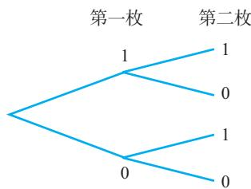

解：用 $i$ 表示朝上面的“点数为 $i$ ”。因为落地时朝上面的点数有 1，2，3，4，5，6 共 6 个可能的基本结果，所以试验的样本空间可以表示为 $\Omega = \{1, 2, 3, 4, 5, 6\}$ 。

例3抛掷两枚硬币，观察它们落地时朝上的面的情况，写出试验的样本空间.

解：掷两枚硬币，第一枚硬币可能的基本结果用 $x$ 表示，第二枚硬币可能的基本结果用 $y$ 表示，那么试验的样本点可用 $(x, y)$ 表示。于是，试验的样本空间

$\Omega=\{(\text{正面，正面})，(正面，反面)，(反面，正面)，(反面，反面)\}.$

如果我们用1表示硬币“正面朝上”，用0表示硬币“反面朝上”，那么样本空间还可以简单表示为 $\Omega = \{(1, 1), (1, 0), (0, 1), (0, 0)\}$ .

如图 10.1-1 所示，画树状图可以帮助我们理解例 3 的解答过程.

  
图10.1-1

对应题目：[Q070000000895](../Q070000000895.md)

> 来源：高中必修 第二册·人教A版数学
